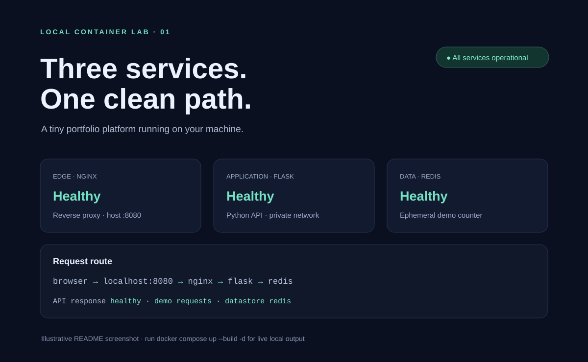
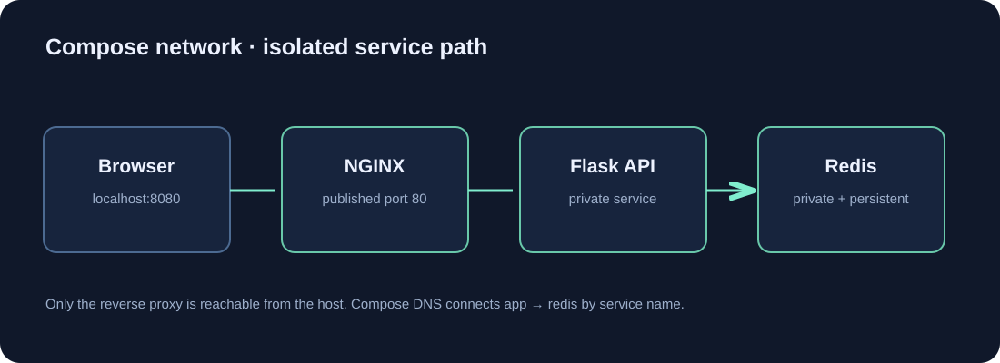

# Containerized Portfolio Demo

A small, reproducible Docker Compose project that serves a responsive portfolio dashboard through **NGINX**, with a Python **Flask** application and **Redis** counter behind it. The page shows live service health, a visit counter, and the request path. All data and assets are fictional; no external API or cloud account is needed.



## Architecture



Browser → `localhost:8080` → NGINX reverse proxy → Flask app → Redis. Compose puts the services on a private bridge network. Only NGINX publishes a host port; Redis is not exposed to the host.

## Stack and tools

- Docker Engine and Docker Compose v2
- NGINX (reverse proxy, static assets, health check)
- Python 3.12, Flask, Gunicorn
- Redis 7 (ephemeral demo visit counter)
- Docker health checks, bridge networking, named volumes

## Run locally

Requirements: Docker Desktop or Docker Engine with the Compose plugin.

```sh
docker compose up --build -d
docker compose ps
```

Open <http://localhost:8080>. The page's request counter increments on refresh. Check the JSON health endpoint at <http://localhost:8080/health>. To inspect logs, use `docker compose logs -f`; stop and remove the stack with `docker compose down`.

## What to explore

- `nginx/default.conf`: route `/` and `/api/` to the app, serve `/health` locally.
- `app/main.py`: simple application endpoint and Redis-backed counter.
- `compose.yaml`: service dependencies, health checks, private network, persistence.
- `Dockerfile`: small, non-root Python application image.

## Security and scope

This is an educational local demo, not a production deployment. It contains no credentials, real users, or external integrations. The counter is illustrative and not a durable analytics system. For production, add TLS, secrets management, resource limits, pinned image digests, monitoring, and a managed datastore.

## Screenshots

The included images are illustrative project screenshots/diagrams prepared for this sample repository. Run the stack to see the live local page.
